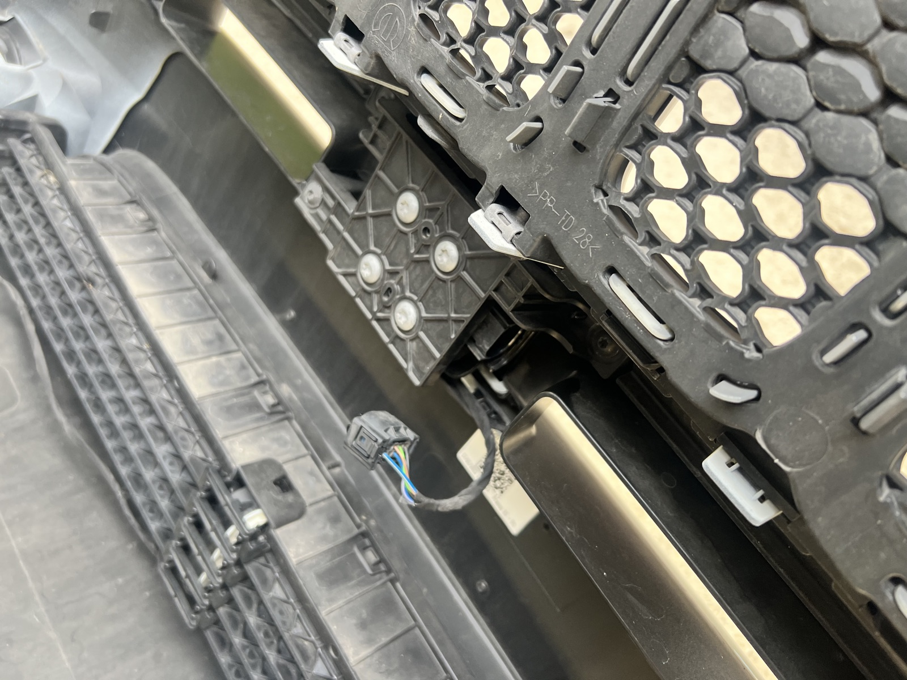
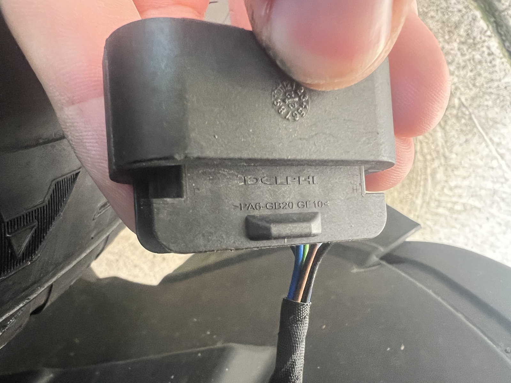

# Finding CAN C

> Written by Claude, the coding agent on this project (drafted on Fable 5.1, revised on Fable 5.2),
> from the session transcripts, tickets and repository history. Aaron did all bench and car work.
> He has read the summary and has not reviewed every page. "I" on this page is the agent; quoted speech is Aaron's. Current as of
> 2026-09-07.

ACC state on a 2023 Renegade is on CAN C, and CAN C does not reach the forward camera. This page
covers the three places we looked for it: the diagnostic port, which is diagnostic-only; an
interposer at the radar connector, which works but sits behind an hour of fascia removal; and the
XY005A inline connector in the wheel well, which is the one the project uses. It ends with the
part numbers and the cavity map. Part of the [Renegade worklog](../README.md).

## What the camera can see

The forward camera connector D2829A (FCA 1/08069/02, a 12-position TE Micro Quadlok) carries
exactly six circuits:

| pin | circuit | function |
|---|---|---|
| 1 | Z909 | ground |
| 4 | D449 | fusion CAN high |
| 5 | D448 | fusion CAN low |
| 8 | D3 | CAN CH high |
| 9 | D4 | CAN CH low |
| 12 | F987 | fused ignition run/acc |

CAN CH is the camera-side bus. The vehicle gateway forwards a subset of CAN C onto it: 25 to 32
IDs out of the 88 on CAN C. The fusion bus is a private point-to-point link between the camera
and the radar, terminated at each end, carrying the radar's object list and a keepalive.

The factory manual names the same bus differently from page to page ("CAN CH" on the end view,
"CAN C2" on DTC pages, "C3 CAN private" for the fusion link), so go by the circuit IDs. The
generic module description page for the camera also gives a pinout that does not match the
vehicle-specific end view. Trust the end view.

The first capture on 2026-07-22 (route 00000003, 17 minutes, 3.81 million frames) settled what
CH carries:

- 0x1F6 is a CUSW `LKAS_COMMAND`. 100 Hz, four bytes, torque in 11 bits, control bit in byte 1
  bit 4. All 107,860 frames pass the existing Chrysler checksum. In this first capture the control
  bit was set in 4.6 percent of frames, in five windows that match the narrated LaneSense
  interventions. Torque range -211 to +303, above CUSW's 250 limit.
- 0x547 byte 3 bit 6 tracks LaneSense enabled state. Six transitions at t = 196.5, 201.0, 206.8,
  209.8, 213.8 and 216.5 s match the narrated toggle sequence exactly.
- 0x384 byte 3 bit 6 is the momentary LaneSense button press, six pulses of 70 to 180 ms.
- 0x101 byte 0 bit 5 is a stock-ACC braking flag, active in four intervals that match narration
  ("cruise slowing us down", 416 to 421 s) and clearing before the driver brakes.
- Seventeen captured IDs overlap `fca_giorgio.dbc`, sixteen with identical DLC, and the Giorgio
  definitions decode sane steering angle, wheel speeds, gas, brake, RPM and driver torque. The
  platform mixes Giorgio body signals with a CUSW steering command.

What CH does not carry is what forced everything that came after:

- CUSW `CRUISE_BUTTONS` 0x2FA: absent.
- CUSW `ACC_HUD` 0x3EE: absent.
- CUSW `ACC_CONTROL` slot 0x2EC: present at 20 Hz, all 21,581 payloads zero.
- Giorgio `ACC_1` 0x5A2: present at 1 Hz, all 1,079 payloads zero.
- An exhaustive low-transition bit scan found no CH or fusion bit matching the cancel or gap
  button timings.

Several false positives had to be killed on the way: 0x4AF byte 3 (flips 71 times route-wide),
0xF1 and 0x1F5 motion bits (drop at every stop), and 0x5A9's stop-departure sequence. The
lesson for the next capture was a marker protocol: the copilot says "MARK n, visible state",
waits two seconds, performs one action, says "RESULT n, new state", then ten seconds of silence.
A confident negative result needs long, isolated states, and word-level transcription of an
ordinary drive cannot create them, so the protocol creates them on purpose.

Two independent read-only reviews on 2026-07-23 converged: no usable ACC state at the camera.
The ACC buttons enter over a LIN circuit to the steering column module, then the BCM. Where the
BCM publishes them was never established from the diagrams alone.

## Option one: the diagnostic port

The J1962 connector carries three diagnostic CAN pairs from the integrated gateway. The wiring
diagrams already showed them as separate stubs, and the capture plan said so: "a clean
electrical tap does not guarantee a transparent data mirror." An evening with a cable was still
cheaper than a console teardown, and Aaron's rule was that nothing comes apart to reach a raw bus
until we know we need that bus.

The cable is a J1962 to female DB25 for a CANsub.4 four-channel recorder. Build facts that
matter if you repeat it:

- Do not trust a drawing for J1962 orientation. The end view in the manual is mirrored versus
  most published diagrams. Find pin 16 with a voltmeter (the only always-hot pin), count inward,
  then confirm with the three roughly 60 Ω pairs (6-14, 12-13, 3-11) and pin 5 to chassis near
  zero.
- No 120 Ω terminators. All three pairs already read about 60 Ω.
- The CANsub.4 has no storage. Its in-browser ring buffer is about 2 million frames, and CH
  alone put 1.72 million frames on it in 17 minutes. Captures stream to a host.

This is the parked preflight on 2026-07-26, with all channels listen-only. In the dashboard,
`bus` is bus load as a percentage and `last` is seconds since the last frame:

```text
 ch  network         frames    rate  IDs  errors  bus    last  status
  1  diag_can_c          83    0/s    45      1    0%   96.8s  STALLED 97s
  2  diag_can_ch    449,594 4584/s     1      3   96%    0.0s  errors
  3  diag_can_ihs         2    0/s     0      2    0%  129.9s  STALLED 130s
```

That is ACK starvation. The diagnostic legs are stubs where the gateway is the only transmitter
and a listen-only tap is the only listener, so nothing acknowledges anything. Channel 2 was one
frame retransmitting at bus rate, and channel 1 went error-passive after 83 frames. With ACK enabled on
channels 1 and 2, the storm collapsed to 13 frames in 2 min 40 s. Every ID decoded as ISO 15765-2
normal fixed addressing, `0x18DA<target><source>` with tester 0xF1, which is openpilot's own boot
fingerprint sweep being routed toward the DLC because it targets 0xF1.

The counts settle it. The busiest ID on channel 1 appeared six times in 160 seconds, where
periodic broadcast would have been tens of thousands of frames, so there is no periodic traffic
on diagnostic C or CH. One cable and one evening produced a definitive negative, and the console
never came apart.

The cable did produce the CANsub capture tool that every later capture used. Its own gotchas are
in the [toolchain deep dive](capture-toolchain.md#the-cansub4-from-python).

## Option two: an interposer at the radar

The radar connector D3098A carries CAN C on pins 2 and 3 and the fusion bus on pins 5 and 6.
On 2026-07-23 Aaron proposed a gateway there that reads CAN C and copies the messages we care
about onto the fusion bus. D3098A already has both networks, so a dual-CAN bridge there replaces
an entire CAN C run to the windshield.

The build: Teensy 4.1 (three native FlexCAN controllers, already on hand) with MCP2562FD
transceivers (3.3 V VIO, so no level shifting; a TJA1050 order was cancelled for that reason).
The vehicle build was receive-only on CAN C at the controller level with no code path calling
write on that bus, and the fusion transceiver held in hardware standby. Two more transceivers
mirrored the raw RXD of each bus onto the TXD of a second transceiver through 1 kΩ. That gave the
CANsub electrically separate copies of both buses with hardware timestamps and error frames, for
the price of two transceivers. The mirror
channels must stay listen-only, since the ACK bit is part of the mirrored waveform driven by the
real nodes.

Connectors TE 1-967658-1 (fits the harness half) and 1-1534229-1 (fits the radar half) were
chosen from catalog geometry and fit on the first physical try. Bus measurements at the stub,
powered down:

| condition | CAN C | fusion |
|---|---|---|
| plugged into car only | ~60 Ω | ~120 Ω |
| plugged into radar only | 44 kΩ | ~120 Ω |
| plugged into both | ~60 Ω | ~60 Ω |

CAN C is terminated elsewhere in the vehicle and the radar is a high-impedance node on it, while
fusion is point-to-point and terminated at each end. Both facts drove the gateway termination
rule later.

Two things went wrong. Hours went into a phantom fault (missing ACKs, repeated frames, zero
receive) that was a bad solder joint: 120 Ω measured at the jumper and at the board where 60 Ω
belonged, and reflowing fixed both channels. Then the vehicle install on 2026-08-13 used
extension cables so the box could sit somewhere reachable in the engine bay. It threw DTCs
installed and DTCs bypassed. The crimps on the extension harness were bad, and the car went back
together without the gateway.



D3098A, above, is behind the front fascia. Using it as an interface point costs about an hour
of prying and a pack of replacement trim clips each time.

## Option three: XY005A

Reassembling the fascia, Aaron noticed an inline connector upstream of the radar, perhaps twenty
positions, carrying the same six wires. It can be reached from inside the wheel well by
unscrewing a small part of the fascia, with the rest left on the car.

The block diagrams call it XY005A. It has no connector end view anywhere in the 84,728-page
factory manual dump and no public part number. Identification came from photos and calipers.



The housing is marked DELPHI and `>PA6-GB20 GF10<` (above), the terminal position assurance is
purple and marked 7A, and cavity letters A and G are moulded at the row ends. My first hypothesis
was a 21-way 3x7, and I wrote an entire research file on that premise before a caliper reading on
the male half killed it: 27.0 mm centre-to-centre from cavity 1 to cavity 7 is six gaps of 4.5 mm,
which is the Aptiv GT 150 sealed family. 24.0 mm would have meant a 4.0 mm family and 25.2 mm the
DSQ 1.5. The apparent third row was the TPA's staggered windows.

The cavity map is on Aptiv's drawing 15326973 for the GT 150 sealed female family.

Parts: female assembly 15326856, male 15326861, purple 14-way TPA 15430904, female terminals
12191818 (0.35 to 0.5 mm²), male 15326268, cable seals 15366021 white (1.20 to 1.90 mm OD) and
15366060 blue (1.86 to 2.40 mm), cavity plug 15305171, CPA 15317832, removal tool 12094429. One to
two dollars each. The residual risk was keying: the drawing's type-214 variant is not sold
commercially and an OEM may well have specced it. Only a fit test could settle that. Do not crimp before the empty housings fit both car halves.

The cavity map, six of fourteen populated:

| cavity | circuit | fascia side | body side | D3098A pin |
|---|---|---|---|---|
| A | fused ignition F948 | DB/WH | DB/WH | 8 |
| B | CAN C high D436 | GN | GN | 2 |
| C | fusion high D449 / D469 | GY | GN | 5 |
| H | ground Z905 | BK | BK | 1 |
| J | CAN C low D435 | BN | BN | 3 |
| K | fusion low D448 / D468 | DB | BN | 6 |

Rows are A to G and H to P, skipping I and O, so B/J and C/K are vertical pairs. The fusion pair
renumbers and recolours across the inline: grey and dark blue on the fascia side, green and brown
on the body side, which gives a free check when probing.

Connector sex is named for the terminal, whatever the shell looks like. The body end takes the
15326856 female, the fascia end the 15326861 male. On 2026-08-21 the Teensy became a jumper-with-taps at XY005A for
three instrumented captures (two drives and the CANsub half of a 60-minute collection run), and
on 2026-08-23 the Red Panda gateway harness was built around the same pair. The Teensy came out of
the car on 2026-08-25 as a crimp-and-connector failure point in series with CAN C, and its
firmware was archived. Once the Red Panda splits CAN C in INTERCEPT, a tap on the radar side stops
being ground truth for the car anyway; it sees only what the gateway forwarded.

## What the captures through XY005A showed

The parked baseline on 2026-08-23: 88 IDs on raw CAN C at 59 percent bus load, about 2,440 frames
per second. Fusion: 13 radar object IDs from 0x200 to 0x380 on a 0x20 stride at 25 Hz plus 0x3A0,
0x3C0 at 1 Hz, and 0x7A9 at 10 Hz static. On the road, 107 IDs over 22 minutes. Seventy-five raw
CAN C IDs never reach comma bus 2 and 82 never reach bus 0; the vehicle gateway forwards a quarter
to a third of CAN C onto CH.

0x103, 0x2FA and 0x73C are among the IDs that stay on CAN C, which is why the gateway exists.
Their decode is in
[CAN findings](can-findings.md#acc-signals-which-are-on-can-c-only).
