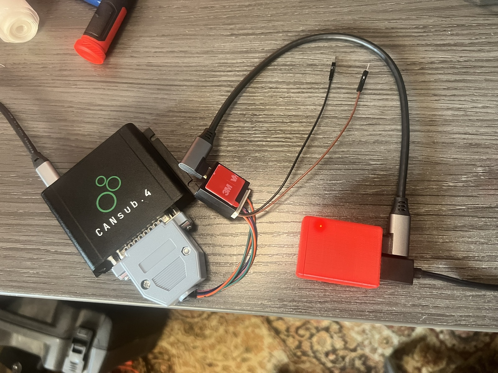

# The Red Panda gateway

The gateway is a Red Panda in a comma developer harness box, inline at XY005A on CAN C, running
its own firmware target `panda_gateway_h7` on the `renegade` branch of `panda/`. It splits CAN C
into a
body half and a radar half, forwards every frame between them in software, and copies three ACC
messages onto the private fusion bus where the comma four can read them. Part of the
[Renegade worklog](../README.md). Current as of 2026-09-07, panda `a7ce33b1`.

## Why this shape

- XY005A is the interface point (see [Finding CAN C](finding-can-c.md#option-three-xy005a)). It
  carries CAN C, the fusion bus, ignition and ground, which is everything a panda in a harness box
  needs.
- Stock openpilot talks to exactly one panda over SPI. Multi-panda and USB panda support were
  removed upstream. Making the Red Panda the comma's second panda would mean reverting that and
  carrying it through every rebase, which would turn a car port into a fork of core plumbing. The
  gateway runs standalone for that reason, and the comma four keeps its stock panda at the camera.
- The comma developer harness box v3 already has a switched CAN pair, power from the vehicle,
  orientation detection, and an OBD-C port. Nothing needed to be designed.

The harness is an 18-pin comma pigtail adapted to both halves of XY005A:

| XY005A cavity | circuit | body-side pigtail pin | fascia-side pigtail pin | panda bus |
|---|---|---|---|---|
| A | fused ignition | P2 | P14 | |
| B | CAN C high | P4 (CAN0_H) | P16 (CAN2_H) | 0 body, 2 radar |
| J | CAN C low | P6 (CAN0_L) | P18 (CAN2_L) | 0 body, 2 radar |
| C | fusion high | P8 and P9 (CAN1_H) | | 1 |
| K | fusion low | P7 and P11 (CAN1_L) | | 1 |
| H | ground | P1 | P17 | |

The Molex iGrid contacts are rated 3 A, so the radar's startup and continuous current on F948
has to be measured before it is routed through P2/P14. Never plug an ordinary USB-C device into
the OBD-C port; the box puts vehicle voltage on VBUS.

## The box is not a relay

The v3 harness box has two DG419 analog SPDT switches where one would expect a mechanical
normally-closed relay, and that changes the failure model:

| state | box power | SBU1 | CAN C body to radar |
|---|---|---|---|
| POWERED BYPASS | on | released | joined through COM to NC; about 6 Ω per switch, 14 Ω per conductor measured end to end |
| POWERED INTERCEPT | on | driven | split, each half on its own panda controller |
| BOX UNPOWERED | off | n/a | open |

The last row is a residual hardware failure mode. Loss of box power cannot be called fail-bypass
and the contract says so. There is a middle case the bench found: a panda powered from host USB
back-feeds the box over OBD-C, so an "unpowered" box with a capture host attached still passes
CAN C. That masks power loss any time a laptop is on the panda. The unpowered row of the table
is really two cases: open with the panda unpowered, passthrough with the panda on host USB.

The SBU drive is active-high. The box drives the DG419 IN pin from SBU1 through a 240 Ω
pull-down: low is passthrough, high is split. The panda's relay GPIO feeds an on-board high-side
stage, and SBU1 measured 5.0 to 5.2 V in INTERCEPT, 0.07 V released, 0.0 V with the panda out.
Grounding either SBU with the panda removed does nothing. The design notes had this polarity
wrong and the bench corrected it.

Orientation: the box grounds one SBU or the other depending on which way the cable is seated, and
the panda picks the lower SBU as the relay line. Both seatings resolved the body half onto logical
bus 0 on the bench, but the margin was small (68 mV versus 289 mV), so the firmware records the
resolved mapping in its status packet, and the whitelist copy takes the body bus from that
mapping every time. The code never hard-codes a bus number.

The gateway's own stuck-switch detector is the panda's standard relay check: the safety policy
lists two body-originated messages, `ABS_1` 0x0EE and `EPS_1` 0x0DE, as relay probes on the
resolved radar-side bus. In INTERCEPT they can only arrive there as the gateway's own forwarded
copy, which the transmit echo filters out, so hearing one received on the radar half means the
halves are still one wire. That latches a relay malfunction and drops to BYPASS. A swapped bus
map would trip it about 1.7 s into every INTERCEPT, since those two messages run at 100 Hz. The
detector is passive; on the bench it was exercised by injecting `ABS_1` on the radar half.

## Termination, decided by the meter

The box adds no termination of its own. Its resistors reach the bus only through the P3-P5
(CAN0) and P13-P15 (CAN2) jumper loops. In BYPASS none of that matters, because the vehicle's own
terminators are on the joined bus. In INTERCEPT each half is its own segment.

On the bench, each half saw only its single CANsub 120 Ω jumper, and that drove the gateway's
transmitter error-passive with stuff errors, so it refused INTERCEPT with `CAN_ERRORS`. Bench
termination became: both loops installed, 120 Ω on each CANsub channel, plus a second 120 Ω
across fusion (the car's fusion is terminated by the radar and the camera, which the bench does
not have).

In the car, the radar is a high-impedance node with no CAN C terminator. When the box splits, the
radar half would be an unterminated stub with kilohms across it, so the car harness has the
P13-P15 loop installed and P3-P5 open. The body half keeps the vehicle's own terminators and the
radar half gets the box's.

## The state machine

The gateway has two states. It boots into BYPASS and stays there. It enters INTERCEPT only when
every entry gate holds continuously for two seconds, and it returns to BYPASS when the heartbeat
lease expires at five seconds, when either half of CAN C goes quiet, on a CAN error, on a relay
malfunction, on ignition off, or on any firmware fault. Five INTERCEPT cycles inside 120 seconds
latch it in BYPASS until reset. The diagram shows the same thing:

```text
        boot / reset / any fault
  ┌───────────────────────────────────────┐
  │                                       ▼
  │   ┌──────────┐  all gates hold on   ┌───────────┐
  │   │  BYPASS  │  every tick for 2 s  │ INTERCEPT │
  │   │ (SILENT) │ ───────────────────▶ │ (gateway) │
  │   └──────────┘                      └───────────┘
  │        ▲                                  │
  │        └──────────────────────────────────┘
  │          heartbeat lease expired (5 s), a half goes quiet,
  │          CAN error, relay malfunction, ignition off, ...
  └── 5 INTERCEPT cycles in 120 s: LATCHED in BYPASS until reset
```

Entry gates, all of which must hold on every 8 Hz tick through the 2 s dwell: harness orientation
resolved, ignition present, CAN and safety initialisation complete, both CAN C cores healthy, and
a valid `COMMA_HEARTBEAT` accepted within the last 5 s with counter progress since the last tick.
"Healthy" is stricter at entry than while running. A core that is error-warning or has logged any
error in the last second may not be intercepted, yet a running intercept rides through either
condition, since tearing down on them would make the relay chatter on a noisy bus. Bus-off, a
bus-off count increase and error-passive always fault.

The fusion core is deliberately left out of the intercept preconditions. When the fusion segment
is sick the gateway stops copying and stops sending its heartbeat, and the CAN C intercept keeps
running.

The heartbeat is the opt-in (Aaron's G4 answer during the competition Q&A). If openpilot is not
running, or is passive, no heartbeat leaves the car and the gateway never leaves BYPASS.

Timing constants: tick 8 Hz, dwell 2 s, hold-off after any bypass 5 s, boot hold-off 10 s (30 s
after a watchdog or software reset), heartbeat lease 5 s, quiet grace 5 s, latch after 5 cycles
in 120 s.

Three transmit paths exist and they are separate. In BYPASS the panda safety mode is SILENT, with
one exception: the gateway may answer a comma heartbeat with its own while fully healthy. In
INTERCEPT the safety mode is the gateway policy, whose transmit hook refuses every message from
the USB host; forwarding between the two CAN C halves goes through the panda's forwarding path,
and the whitelist copies and the gateway heartbeat go through a firmware path that bypasses the
transmit hook and is restricted to bus 1.

The heartbeats on the fusion bus: `COMMA_HEARTBEAT` 0x5F0 from openpilot at 10 Hz, DLC 8, FCA
CRC-8 over bytes 0 to 6, a 4-bit counter with a forward-step rule and an alive bit.
`GATEWAY_HEARTBEAT` 0x5F1 back at 4 Hz carrying state, blocking reason, harness status and the
resolved body bus. Both IDs were chosen outside the radar's observed 0x200 to 0x3C0 and 0x7A9
range.

## The whitelist

Exactly three messages are copied from CAN C to the fusion bus in INTERCEPT, each from the half
it originates on:

| address | message | DLC | rate | source half |
|---|---|---|---|---|
| 0x103 | ACC_STATUS_1 | 8 | 100 Hz | body |
| 0x2FA | CRUISE_BUTTONS | 4 | 50 Hz | body |
| 0x73C | ACC_HUD | 8 | 1 Hz | radar |

The copy preserves payload, counter, checksum and timing, produces exactly one copy, never
recurses onto bus 1, never duplicates a transmit echo, and never happens in BYPASS or any
non-gateway safety mode. The first sketch had five IDs; review cut 0x1F8 (absent from the
evidence) and 0x1F4 (its ID belongs to the ACC command family in prior-art layouts, so labelling
it "gear" was dangerous), and separately rejected 0x15C because it duplicates 0x103's engagement
state with no consumer.

The source half column exists because the in-car capture contradicted the spec. Every competition
entry and the gateway spec assumed all three originate on the body half. In INTERCEPT the drive
capture showed the radar half receives exactly 0x15C and 0x73C, and everything else on the body
half. `ACC_HUD` is sent by the radar module. With "body half only" it was never copied, and
`cruiseState.available` stayed false, so openpilot could not engage. Per-ID source side is the
stricter rule: an ID heard on the wrong half is never a copy source, since in INTERCEPT the other
half only carries the gateway's own forwarded echo.

## What the bench found

The bench rig is a spare box, a spare Red Panda, a CANsub.4 on three channels (body half, radar
half, fusion), a fourth channel as a second fusion ACK node, and a 12 V supply on the ignition
pin. The CANsub transmits on the bench (heartbeat stand-in, vehicle-rate replay of captured CAN
C, relay-fault stand-in), which it never does in the car.



The relay truth table, measured:

| state | SBU1 | body to radar | probe frame reaches the other half |
|---|---|---|---|
| powered BYPASS | 0.07 V | 14 Ω per conductor | at 0 µs, because it is one wire |
| powered INTERCEPT | 5.2 V | split | 263 µs later, as the gateway's forwarded copy (one 8-byte frame time) |

That 0 µs versus 263 µs classification replaced the meter for every later row, since fusion
shares the DB25 and unplugging it drops the heartbeat.

Fault and timing measurements:

| event | measured |
|---|---|
| cold boot to INTERCEPT | about 12 s (10 s hold-off, first heartbeat reply, 2 s dwell) |
| software reset to SBU1 released | 0.195 s, then a 30 s hold-off |
| heartbeat loss to relay released | 5.09 to 5.13 s |
| heartbeat stop, freeze, bad CRC, DLC 7, alive bit clear, A/A+1 alternation | relay released within 4.93 to 5.07 s |
| 9-frame counter loop, or A/A+8 alternation | holds INTERCEPT (accepted residual of a 4-bit counter) |
| relay-fault stand-in (ABS_1 injected on the radar half) | forwarding stopped 1.66 s after entry, relay released at 3.4 to 3.5 s |
| latch | exits at 8.7 to 9.0 s intervals, latched on the fifth at 44.6 s, held 70 s, cleared only by reset |
| heartbeat at 3 Hz (333 ms gaps) | never enters; at 5 Hz enters in 2 s |
| USB safety-mode, CAN-timing and power-save requests from INTERCEPT | all silently refused |
| longest clean INTERCEPT hold | 29 min 20 s, 0 CAN errors |

The 3 Hz row means openpilot's 10 Hz stream must not gap more than 250 ms during the dwell.
Measured in the car, the worst gap over a 23-minute drive was 238 ms.

**A parked error counter never decays.** A CAN core that reaches error-passive without going
bus-off keeps its transmit error counter at exactly 128. In BYPASS the core is in monitor mode and
never transmits, so the counter never decays, and re-initialising the peripheral does not clear
FDCAN error counters; only the bus-off recovery sequence or a peripheral reset does. The counter
parks at exactly 128 because a transmitter that is already error-passive stops counting ACK
errors, so ACK starvation is the canonical trigger. Seen three ways on the bench: a hand short on
the radar half, and twice when the CANsub's radar channel died mid-run. On the fusion core it is
worse: sixteen unacknowledged gateway heartbeats park the counter, the link-health check fails,
the transmit gate shuts, and 0x5F1 stops until the panda is reset.

The fix, panda `caf1ac75`: in BYPASS the 1 Hz tick counts consecutive seconds with any core
error-passive. At 2 s it pulses `RCC->APB1HRSTR.FDCANRST`, which resets all three FDCAN instances
in one line. It then re-runs `can_init_all()`, re-snapshots the error counters so the reset is not
read as an error burst, and increments a `can_recoveries` byte in the status packet. Never in
INTERCEPT. The host tests model the sticky counter. The way to reproduce it on a
bench is a listen-only radar channel. Don't short the bus by hand.

The in-car capture the next day showed the sibling. Ignition off while the panda stays alive on
USB (or on the comma's power) parks the radar-half counter at 127, one ACKed frame below
error-passive, in error-warning. The strict entry check refuses on error-warning and the recovery
only watched error-passive, so `CAN_ERRORS` was sticky until a power cycle. Panda `a7ce33b1`
extends the recovery to error-warning with a non-zero transmit count, runs with ignition off too,
and leaves receive-side warnings alone because they decay with traffic. Measured in the car:
ignition off, recovery in 2.1 s, ignition on, INTERCEPT 8 s later with no power cycle.

Forwarding at vehicle rate, captured CAN C replayed at 2,291 frames per second on the body half
for 153 s of INTERCEPT:

| direction | sent | crossed | missing | p50 | p99 | max |
|---|---:|---:|---:|---|---|---|
| body to radar | 349,913 | 349,913 | 0 | 390 µs | 603 µs | 800 µs |
| radar to body | 1,445 | 1,445 | 0 | 608 µs | 1,754 µs | 2,048 µs |

Gateway counters agreed exactly with the wire. Zero errors on all three cores, interrupt load
0.15. Under a replayed radar track stream at 336 fps the whitelist copies were 11,355 of 11,355,
5,679 of 5,679 and 120 of 120, payload-identical, p50 about 250 µs with a p99 of 1.7 to 3.1 ms
when a copy queues behind a radar burst. Negatives all zero: 0x103 from the wrong half, DLC 7,
29-bit 0x18000103, non-whitelist traffic (414,000 frames, nothing on fusion), and 0x2FA flowing in
BYPASS.

In the car, the gateway held INTERCEPT with zero state changes across the first 23-minute
shakedown drive.

## The contract

A written contract governs the firmware. Two of its five rules were added after measurements,
and the original design did not have them:

1. At boot, reset, watchdog, heartbeat loss, safety-init failure, relay fault, CAN bus-off or
   any firmware fault while the box remains powered, release SBU1 and return to POWERED BYPASS.
2. SBU1 may be driven only after orientation is resolved, ignition is present, CAN and safety
   are initialised, both CAN C cores are healthy, and openpilot has opted in with a fresh
   heartbeat, plus the hold-offs, dwell and latch above.
3. Loss of box power cannot be claimed as fail-bypass. The residual CAN C open is documented and
   accepted. (From the splitter measurements.)
4. A parked CAN core is reset after 2 s in BYPASS, never in INTERCEPT. (From the bench.)
5. USB presence is not part of the vehicle-state decision. The capture host never selects the
   safety mode, controls the relay or provides the heartbeat.

Two open items on the map: whether the gateway should send its heartbeat at all in BYPASS (a hung
comma replaying one frozen frame keeps it chatting), and whether to accept the unpowered-box
residual or add a true hardware bypass.

## Numbers to remember

| measurement | value |
|---|---|
| cold boot to INTERCEPT | about 12 s (32 s after a software reset) |
| heartbeat loss to BYPASS | 5.0 s |
| forwarding latency, body to radar | p50 390 µs |
| whitelist copy latency | p50 about 250 µs |
| longest bench hold | 29 min 20 s, 0 errors |
| heartbeat gap that blocks entry | over 250 ms during the dwell |
| car harness jumpers | P13-P15 installed, P3-P5 open |

## Provenance

Written by Claude (drafted on Fable 5.1, revised on Fable 5.2) from the project's transcripts,
tickets and repository history; Aaron did the bench and car work. He has read the summary and has not reviewed every page.
