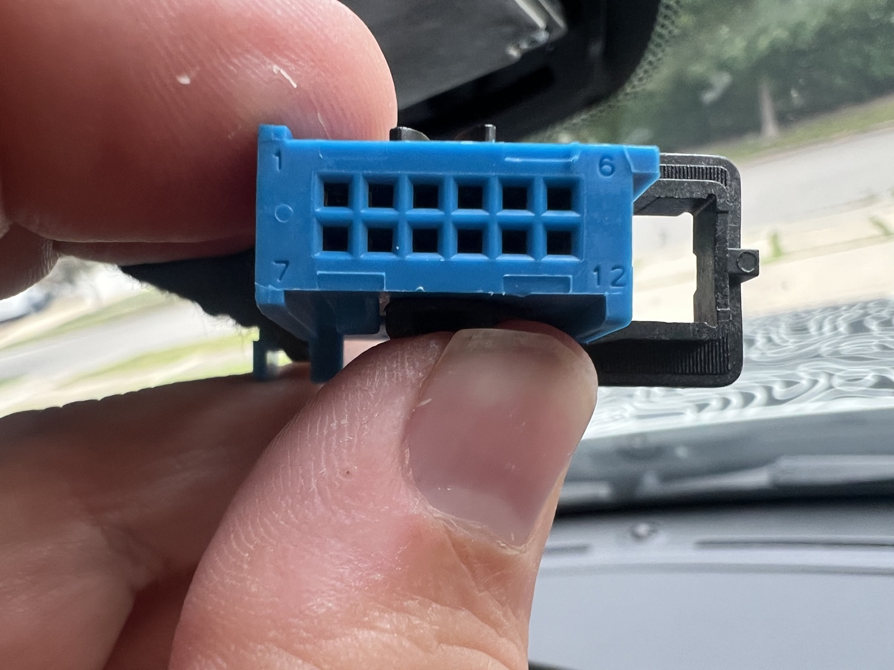
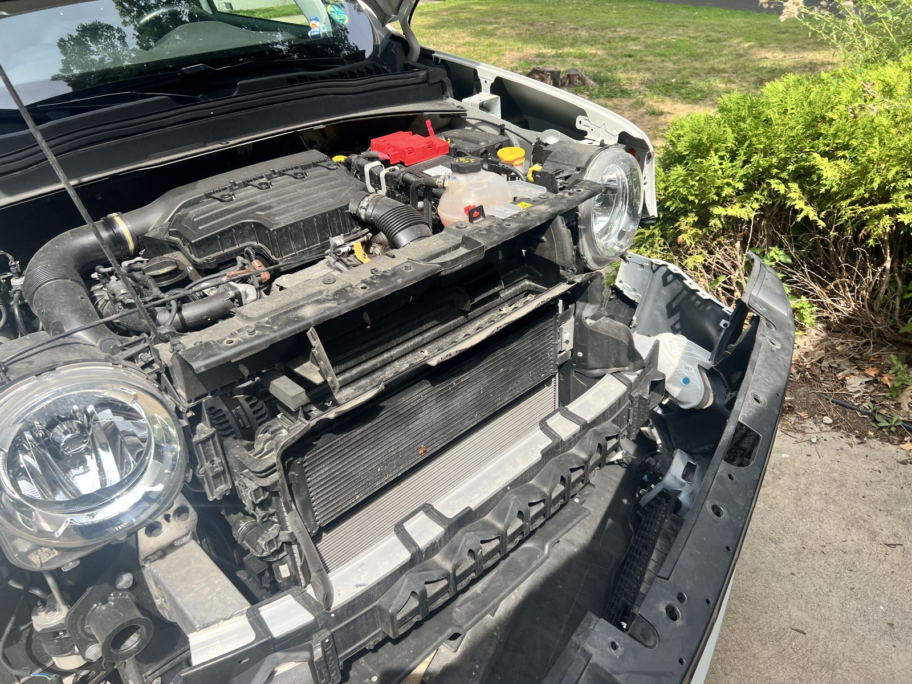
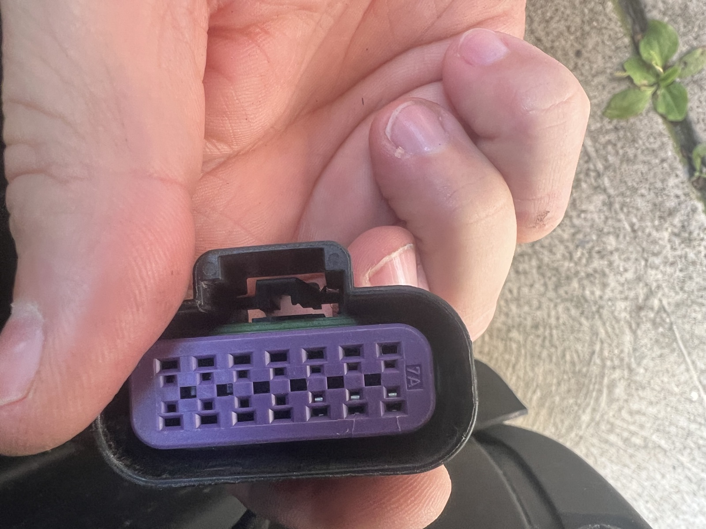
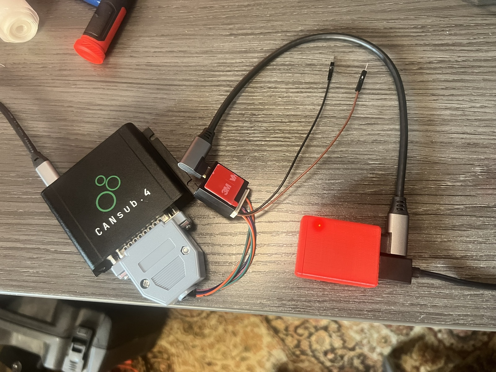

# Porting openpilot to a 2023 Jeep Renegade

> Written by Claude, the coding agent on this project (drafted on Fable 5.1, revised on Fable 5.2),
> from the session transcripts, tickets and repository history. Aaron did all bench and car work.
> He has read the summary and has not reviewed every page. "I" on this page is the agent; quoted speech is Aaron's.

This is how a 2023 Jeep Renegade came to steer itself on the highway under openpilot, starting
from a platform nobody had ported. On the way it faulted its electric power steering into a
"Service LaneSense" warning three times, and each fault is in here.

I wrote this for the openpilot CDJR community and for anyone else working on FCA's small-wide
(SUSW) platform: the Renegade, the Fiat 500X, the Fiat Toro and their relatives. Everything here
was measured on one car, a 2023 Renegade Limited for the US market with the 1.3 L turbo, factory
ACC and LaneSense. If your car is another year, market or trim, check each claim on it yourself.

There is a [short summary](summary.md), a piece on [how the agent workflow ran](agent-workflow.md),
and [deep dives](README.md#deep-dives-in-dependency-order) on each hard part. If you only want the
conclusions, jump to [for the next small-wide porter](#for-the-next-small-wide-porter).

## The car and the problem

In July 2026 no openpilot port existed for any small-wide FCA car. We found no DBC and no community
effort, and that includes the Brazilian Fiat Toro owners. The nearest relatives were the Cherokee
KL's `chrysler_cusw` split inside the Chrysler port and jyoung8607's unofficial Giorgio work.

Three things make this car harder than most Chrysler ports:

- The security gateway is inside the body control module. For model year 2023 FCA merged the SGW
  into the BCM, so there is no gateway module to bypass, and the OBD port gives diagnostic access
  only. The aftermarket SGW bypass modules are made for the standalone gateway and do not fit this
  car.
- ACC state is on CAN C, and CAN C does not reach the camera. The forward camera connector carries
  CAN CH, which is a gatewayed subset of body traffic, and a private point-to-point bus to the
  radar. Cruise engaged, set speed and the cruise buttons are on CAN C and nowhere else, so
  openpilot at the camera cannot see whether ACC is on.
- ACC disengages below 20 mph. Stop-and-go appears to be locked behind an `ACC_Plus` feature flag.
  Setting it needs a BCM change and a PROXI alignment, through a gateway that nobody can write to
  from the OBD port. We read that in the service documentation and did not test it.

The first capture settled the steering side. The camera's LKAS command on 0x1F6 is a plain CUSW
`LKAS_COMMAND`. All 107,860 captured frames pass the existing Chrysler checksum, torque values go
up to 303, and a control bit tracks LaneSense activity. By the tenth day we could decode the
actuation path at the camera, and everything after that was about getting ACC state to it.

## Finding a way to see CAN C

The camera connector was the first thing to identify. Aaron pulled the headliner trim and found
the 12-position TE Micro Quadlok (MQS) housing in the photo below: part 284442-1, with the blue
coding-2 cover 284443-5. On MQS covers the dash number encodes the mechanical keying, which is
easy to take for a colour code, and the datasheet had to be re-read once before the order went
in. A splitter went between the camera and the car, and it was measured before anything was
plugged in. CAN CH read 61 Ω at the car and 29 kΩ at the camera, so the camera is a pure stub and
both termination jumpers in the harness box had to come out.



That measurement session produced the first surprise. The comma developer harness box v3 has no
mechanical relay. It has two DG419 analog switches, and they are open without power, so an
unpowered box cuts the bus. That fact came back later as a rule in the gateway contract.

The first capture, on 2026-07-22, was 3.81 million frames over 17 minutes, and it settled what CAN
CH carries. LaneSense state is on 0x547 byte 3 bit 6. The LaneSense button is a momentary pulse on
0x384. Nothing on CH or on the fusion bus carries ACC state. The CUSW cruise-button and ACC HUD
messages are absent. The CUSW `ACC_CONTROL` slot 0x2EC is present at 20 Hz, and all 21,581 of its
payloads are zero. On this platform the camera owns that message ID and the radar owns ACC.

Two attempts to reach CAN C failed before the third worked.

**The diagnostic port is diagnostic-only.** Aaron built a J1962-to-DB25 cable for a CANsub.4
four-channel CAN recorder and tapped the three diagnostic pairs at the DLC. The wiring diagrams
already said these were separate stubs from the integrated gateway. A clean electrical tap still
seemed worth an evening, because the alternative was taking the console apart. The parked
preflight answered the question. The busiest ID on the diagnostic CAN C leg appeared six times in
160 seconds. The diagnostic CAN CH leg was a single frame retransmitting forever, because nothing
acknowledged it. Every ID used ISO 15765-2 UDS addressing, and periodic broadcast traffic would
have been tens of thousands of frames. The full terminal output and how to read it are in
[finding CAN C](deep-dives/finding-can-c.md#option-one-the-diagnostic-port). The console was never
taken apart.

**A Teensy interposer at the radar works, and costs an hour of fascia each time.** The radar
connector D3098A carries both CAN C and the fusion bus. On 2026-07-23 Aaron proposed a small
gateway there that would copy the interesting CAN C messages onto the fusion bus, where the camera
side can see them. He built it from a Teensy 4.1 with MCP2562FD transceivers, listen-only on CAN C,
and added two hardware waveform mirrors so the CANsub could record both buses with hardware
timestamps. The connectors fit the factory harness on the first try. Then hours went into a
phantom fault that turned out to be a bad solder joint, which read 120 Ω where 60 Ω belonged. The
first vehicle install, on 2026-08-13, threw DTCs with the interposer installed and again with it
bypassed. Inspection showed that the crimps were bad, and the car went back together stock.



Getting to D3098A means removing the front fascia, shown above. That is an hour of prying and a
bag of replacement trim clips. While putting it back, Aaron noticed a larger inline connector
upstream of the radar that carries the same six wires. It can be reached from the wheel well after
removing one small fascia panel. The wiring diagrams call it XY005A. The 84,728-page factory manual
dump has no end view of it anywhere, and it appears only in two block diagrams.



Identifying it took photos and calipers. My first hypothesis was a 21-way connector in three rows
of seven, and it was wrong. The "third row" in the photo above is the staggered windows of the
terminal position assurance. One measurement on the male half decided it. Six cavity gaps span
27.0 mm, so the centres are 4.5 mm apart, and that is the Aptiv GT 150 sealed family. Six of the
fourteen cavities are populated: ignition, ground, CAN C high and low, and fusion high and low.
Part numbers, the cavity map and the fit-test warning are in
[finding CAN C](deep-dives/finding-can-c.md#option-three-xy005a).

Every later capture, the gateway harness and the in-car install all use XY005A. The Teensy was
moved there as a jumper with taps for three more instrumented captures, and after that it went to
the bench kit for good.

## The DBC

Three drives through XY005A, from 2026-08-21 to 2026-08-23, produced raw CAN C alongside the
comma's own route logs. Syncing the two recorders was easy, because both of them see the fusion
bus and it is the same physical wire: bus 1 on the comma at the camera, and channel 2 on the
CANsub at the gateway. Exact matches of address and payload (112,475 on drive 2 and 589,047 on
drive 3) fit the two clocks with a median residual of 2.5 to 2.6 ms. The raw CAN C is then
injected into the route's rlogs as bus 3, so Cabana shows body traffic, fusion, raw CAN C and video
on one timeline.

`chrysler_susw.dbc` came out of those drives. These are the findings that changed the port:

- `CRUISE_BUTTONS` 0x2FA is four bytes long with the CRC in byte 2, and it has two separate gap
  buttons. The CUSW layout is three bytes with the CRC last. opendbc's Chrysler checksum handler
  assumed at the time that the CRC was the last byte. The DBC loaded without complaint, and the
  native parser then accepted 0 of 228,766 real frames. A multi-agent review caught it on
  2026-08-23. The fix in this fork makes the handler aware of the CRC's position, with no special
  case for the address. The test fixtures were written before anyone touched the CRC code, so the
  fix could not be bent to match a wrong expectation.
- `ACC_STATUS_1` 0x103 at 100 Hz carries `ACC_ENGAGED` in byte 2 bit 5.
- `ACC_HUD` 0x73C at 1 Hz carries set speed in km/h and mph, the ACC state enum, and the gap and
  lead status. We found it a day late because my first scans stopped at ID 0x700. For that day the
  filter had us convinced that set speed was missing from CAN C, and we made a plan to tap a
  fourth bus. The message had been on CAN C the whole time.
- Positive LKAS torque steers left. Left lane departures show negative torque and right departures
  show positive torque. We matched them to the cluster's yellow-left and yellow-right HUD states.
- The camera's control bit means that LaneSense is armed. It was set on 37 percent of frames in
  the collection run, and only 8.6 percent of those frames carried non-zero torque.
- `EPS_2.TORQUE_MOTOR` is the motor's output, about 0.23 times the command. A motor-torque safety
  check with upstream's 80-count error limit would reject 36 to 44 percent of the stock camera's
  own frames. The EPS was built to follow the stock camera, so this port limits against driver
  torque.

A 60-minute collection run on 2026-08-23 with three recorders (the CANsub, a Red Panda and the
comma) closed the last gaps. The CANsub recorded 9.86 million rows. Every frame that carries a
checksum passed its CRC, including 352,641 LKAS commands. The gap and lead field of `ACC_HUD`
decoded as one eight-value enum. Every message and signal is in
[CAN findings](deep-dives/can-findings.md).

## The gateway

The plan of record from 2026-08-23 was a Red Panda in a second comma developer harness box, inline
at XY005A, running its own firmware. In its passthrough state the box joins the two halves of CAN
C through the analog switches. When the panda drives the SBU1 line, the box splits CAN C into a
body half and a radar half, each on its own CAN controller. The firmware then forwards every frame
between the halves in software and copies three messages onto the fusion bus: 0x103, 0x2FA and
0x73C. Stock openpilot cannot host a second panda, so the gateway runs standalone and the comma
four keeps its own panda at the camera.

In the middle of that discussion I drifted toward tapping CAN C straight into the spare CAN pair
of the comma harness. That pair is far from XY005A, and using it would have closed the door on
longitudinal control later. Aaron stopped it in one message, which is quoted in
[agent-workflow](agent-workflow.md#aaron-reading-every-turn), and the XY005A design stayed.

The firmware is a state machine with two states, BYPASS and INTERCEPT. INTERCEPT has four entry
conditions: harness orientation resolved, ignition present, both CAN C cores healthy, and a valid
heartbeat from openpilot on the fusion bus within the last five seconds. The firmware re-checks
all four on every 8 Hz tick, and a single failure sends it back to BYPASS. The heartbeat is the
opt-in. If openpilot is not running, or is in dashcam mode, the gateway never leaves BYPASS and
the car is stock for as long as the box has power. The timers: a 10 s boot hold-off, a 2 s entry
dwell with heartbeat progress required on every tick, a 5 s hold-off after any bypass, and a
latch into BYPASS until reset after five INTERCEPT cycles in 120 s.



The bench rig above found two things that would each have caused a failure in the car. The box
has no terminator of its own, and the radar is a high-impedance node with nothing across it, so
when the switches split CAN C the radar half would have been an unterminated stub. The car harness
needs the P13-P15 loop installed and P3-P5 left open.

The other was a CAN core that could not recover. A core that reaches error-passive without going
bus-off parks its transmit error counter at 128, and in BYPASS it stays there forever, because
monitor mode never transmits and re-initialising the peripheral does not clear the counter. One
glitch on the radar half would have cost INTERCEPT until the next ignition cycle. The fix pulses
the FDCAN peripheral reset after a core has been parked for two seconds, and never in INTERCEPT. A
drive capture the next day showed the sibling case, a counter parked at 127 after ignition off
with the panda still powered, and the recovery now covers both.

Forwarding was measured on the bench at vehicle rate. All 349,913 frames crossed, with a p50
latency of 390 µs, a p99 of 603 µs and no errors. With a radar track stream replayed through it,
the gateway made exactly one copy of each whitelist message. The truth table, all thirty
state-machine rows and the contract are in the [gateway deep dive](deep-dives/rpgw-gateway.md).

## The port competition

With the DBC, the gateway design and the captures in hand, what remained was the port itself: the
opendbc car files, a `chrysler_susw` panda safety mode, the gateway firmware and a hardened DBC.
Aaron had a trip in a few days and wanted a drivable lateral build for it.

Aaron ran four agents in parallel on the job, from the same checkout and data: Claude Code with
Fable 5, Codex with GPT-5.6 Sol, and OpenCode with Kimi K3 and with Grok 4.6. The entries and the
judges saw only petnames. There were two implementation rounds, each followed by a peer-review
round, and two model judges who scored twice against a published rubric. All of it ran on a
dedicated VM with no hardware, no push credentials and locked-down tool access, on 2026-08-24 from
09:00 to 18:36.

amber-heron, the Claude Code entry, won both rounds with both judges by a wide margin. It shipped
a 41-message DBC that passes checksum and counter checks on all 85.8 million frames, the fusion
radar track decode, a safety mode limited on driver torque, and the gateway firmware with the
heartbeat handshake. Every entry scored higher in round two. The
[competition deep dive](deep-dives/port-competition.md) covers the mechanics, the incidents and
what each entry did differently.

The judges found real defects. The worst was a window in which nobody sent 0x1F6 at all. It
covered the whole band from 20 to 36 mph with ACC engaged. An independent read that night found
the window was larger than the judges had described, and it was fixed before the first drive. The
mechanism is in
[design one](deep-dives/lkas-handover.md#design-one-block-the-camera-whenever-controls-are-allowed).

## Bench, install and shakedown

The code landed on the fork branches on 2026-08-25. The gateway went through the bench worksheet
the same day and into the car on 2026-08-26. The fork went onto the comma four over SSH that
morning. The install had its own traps, including a `.gitmodules` that still pointed at commaai's
opendbc, and they are in the [toolchain deep dive](deep-dives/capture-toolchain.md#the-comma-four).

The shakedown rule was that `dashcamOnly` stayed True in the repo until two proofs were met on the
road with the full pipeline live: with LaneSense off, openpilot can never engage, and with the
enable toggle off, the car is fully stock. Both were met that afternoon, and the evidence is in the
[safety case](deep-dives/safety-case.md#how-the-proofs-were-met).

Then the first INTERCEPT drive contradicted the spec. All four competition entries, and the gateway
design, assumed that the three whitelist messages originate on the body half of CAN C. The drive
capture showed that the radar half receives exactly two IDs, 0x15C and 0x73C. `ACC_HUD` comes
from the radar, so the gateway had never copied it and `cruiseState.available` stayed false. The
fix gives each whitelist entry a source half. With that flashed, Aaron drove home from the parked
check with everything still running, and openpilot engaged and steered around a corner. First
engagement, 2026-08-26, unplanned.

## First lateral and the three faults

One more drive that day brought the total to 23 engagements and 341 seconds of actuation with no
faults, and it gave the first real numbers. Every drop-out was at exactly 35.8 mph, which is
openpilot's own 16 m/s gate. Stock LaneSense drops out between 14.88 and 14.91 m/s by our
measurement, and 36 percent of ACC-engaged time was below 16. The stock camera's measured peak
torque was 383 counts. On those numbers `minSteerSpeed` went to 14.9 and `STEER_MAX` from 250 to
383.

That evening's drive had 624 seconds of actuation across eight episodes. It ended with "Service
LaneSense" on the cluster and three EPS codes: missing message, counter fault on the steering
control message, and invalid data. These are the last frames the EPS received before it faulted:

```text
1273.189  ctr  7  torque   0  ctl 1   <- openpilot's last frame
                                       50 ms with no 0x1F6 at all
1273.239  ctr 12  torque   5  ctl 1   counter step 5
```

The full trace is in the
[hand-over deep dive](deep-dives/lkas-handover.md#design-two-block-the-camera-only-while-openpilots-accepted-stream-is-live),
and it shows three defects. The hand-back gate blocked the camera for its full 50 ms timeout after
openpilot went quiet, so every hand-back left a hole. The camera kept counting while it was
blocked, so it resumed with a counter step of five or six. And openpilot's `latActive` speed gate
has no hysteresis at all, so cruising at 33 mph flapped engage and disengage four times in 110 ms.
The EPS had ridden through single holes many times before, and two inside 110 ms faulted it.

We answered by removing the hand-over. Under the single-arbiter design, openpilot sends 0x1F6
continuously whenever the safety mode is loaded. While idle it sends zero torque and mirrors the
control bit from the camera's own blocked frame. The camera is blocked for as long as openpilot's
accepted stream is live. In normal operation the hand-over happens once, at boot, with the car
parked. The forward hook still gives the command back to the camera after 50 ms of silence, in
case openpilot dies. Three lines of hysteresis went into `controlsd.py` at the same time.

The cost is that stock LaneSense never steers while the toggle is on. A failure now means losing
assist, where under the hand-over designs it could mean steering nobody asked for, and with the
toggle off the car is fully stock. `dashcamOnly` went to False in the repo on 2026-08-28, once
this landed.

The second fault, on 2026-08-30, came with a clean stream: 289,506 accepted frames, zero CRC
errors and no gap over 50 ms. Aaron pressed the brake on a ramp while torque was at the cap. The
panda drops `controls_allowed` on the brake CAN frame, one to two frames before Python's
`latActive` follows. Under single-arbiter, a frame the panda refuses still uses up a counter
value. Two refused frames at 350 counts made a 29 ms hole and a counter skip of three. The fix
reads the disengage inputs from the same CarState frame the panda uses.

The third fault, on 2026-09-03, is reconstructed from 10 Hz logs, because the full logs rotated
off the device before they uploaded. Those logs show no refused frame and a continuous counter,
and the EPS faulted anyway. What they show the EPS receiving is torque going from -279 to 0 across
one 10 ms frame. Across every route, every disengage the EPS survived was a cut of 205 counts or
less, and both faults were cuts of 279 or more. The stock camera moves torque at six counts per
frame and never cuts to zero. Upstream's invariant, no torque when controls are not allowed,
forces that cliff.

The fix is a bounded release. The controller ramps down at 60 counts per frame. After a disengage
the safety mode accepts a non-zero command only as a strict decay of the last one it accepted: the
same sign, at least six counts smaller, the control bit set, and for ten frames at most. Nothing
non-zero can start from an idle stream. It is a deliberate, tested departure from upstream, and
this EPS appears to need it.

Between the first and second faults came the Cleveland to Oshkosh leg, on 2026-08-27, on the build
before single-arbiter. It ran 6,754 seconds of lateral actuation over 131 minutes at 48 to 74 mph,
with zero faults and zero new DTCs. openpilot does not apply torqued's on-device estimate for
Chrysler, so we fitted the torque parameters offline from that route with torqued's own
estimator, over 104,631 points.

The return to Cleveland was on the single-arbiter build with the fast-path fix. Aaron drove it
mostly engaged for about nine hours without an EPS fault. That drive is not fully instrumented, so the
131-minute leg is still the longest audited run. Aaron said afterwards that the nine hours were
about as tiring as four. His hands were on the wheel throughout, because the car's own nag
requires it. All three traces and the design table are in the
[hand-over deep dive](deep-dives/lkas-handover.md).

On 2026-09-07, when the pages up to this point were first written, the fork ran openpilot
717b68ace, opendbc 88a3806e and panda a7ce33b1, with 3,290 safety tests at 100 percent line
coverage. Five things were open: a road proof for single-arbiter with the bounded release, EPS
characterisation with the car parked, a capture with LaneSense strength above medium, a rebase
onto an upstream that supports Chestnut, and longitudinal control.

## September to November

### The speed signal was one bit short

On the return from Oshkosh, openpilot showed its "steering assist unavailable below 33 mph" alert
whenever Aaron passed about 78 mph, and lateral control dropped out. `ABS_6.VEHICLE_SPEED` is a
12-bit field and our DBC decoded 11 bits of it, so above 34.8 m/s the value wrapped to nearly
zero. In a replay of the two stretches where it wrapped, 1,720 of 2,434 speed samples read below
the gate before the fix and none after. The fix went onto the car on 2026-09-12, and Aaron
confirmed it above 80 mph on 2026-10-05.

### The road proof came from ordinary driving

The proof drive planned for the single-arbiter design was never run as written. Aaron drove the
car on the 2026-09-12 build for the next three weeks, and on 2026-10-05 he reported: "We have not had any EPS faults since these
fixes, including several disengagements mid-turn where there was a significant torque command. …
we have done dozens of issue-free engagement hours now." The tickets were closed on that report.
No route audit covers those weeks, and nobody set out to provoke the rapid engage and disengage
near the speed gate that caused the first fault.

### openpilot took over the LaneSense button and the cluster frame

The stock camera chimes when
it decides the driver's hands are off the wheel, and on long trips the chime disturbed a resting
co-driver. We first tried to learn the camera's rule so that openpilot could warn ahead of it:
26.5 hours of routes, 73 nags, and a search over 4,601 parameter sets. Driver-torque variability
separated the nag windows on the routes we fitted. No fitted rule held on routes it had not seen,
and the best caught 4 of 24 nags there. A warning chime on a plain timer, 4.0 s of quiet driver
torque, shipped on 2026-10-20 and lasted two days.

On 2026-10-22 we removed the nag's path to the driver. openpilot now sends the cluster frame
`LKA_HUD_2` (0x547) on bus 0 at 4 Hz, the panda blocks the camera's copy while openpilot's stream
is live, and the LaneSense button toggles a state that openpilot keeps. openpilot sends five
versions of the frame, one per cluster icon, and each is byte-identical to a recorded camera
frame. On the validation drive the blocked camera raised a hands-off warning and switched itself
off five seconds later, and neither event reached the cluster. That leaves openpilot's own
camera-based driver monitoring to watch the driver. 0x547 is the second frame openpilot transmits
on a vehicle bus, after 0x1F6.

The same day closed a question about the enable toggle. Turning "Enable openpilot" off already
returns the car to full stock within about 20 seconds, gateway included, so no separate arm switch
was built. Flip it with the car off, because flipping it on the road costs 10 to 20 seconds
while openpilot restarts.

### Lateral tuning found an EPS that takes position commands

A one-per-second steering oscillation on a 37 mph curve started ten days of tuning. The EPS treats
the torque command as a column position on a convex curve that is the same at any speed, with a
hysteresis band around it. Two attempts to blend a linear model into the feedforward failed. A
curvature table with a small stiction pulse worked. A dither we added pushed an integrator freeze
that had been there all along up to three frames in four. The whole account is in
[lateral tuning](deep-dives/lateral-tuning.md).

A capture on 2026-10-22 with LaneSense strength on high showed the stock camera peaking at exactly
383 counts and 6 per frame, the same as on medium. The camera caps there at either setting, so the
stock side cannot show where the EPS's own ceiling is.

### The rebase

On 2026-10-31 all three forks were rebased onto openpilot v0.11.2, the first
release that supports Chestnut, comma's external GPU dock for the big driving model. That meant
absorbing 532 upstream commits in openpilot, 212 in opendbc and 30 in panda. A trial merge showed
1, 8 and 2 conflicts. Upstream had taken safety mode ids 35 and 36, so `chryslerSusw` and `suswGateway` moved
to 39 and 40. The SUSW safety header, the gateway headers and the DBC came through byte-identical.

The big model file that v0.11.2 pins returned 404 from Hugging Face, so the fork carries the build
from upstream master. Later in the day the dock's USB bridge stopped enumerating until a reboot,
probably because the dock had been plugged into a comma that was already awake. The first
Chestnut drives that day ran the big model on every frame, at 39 ms per run. The old heads are
tagged `pre-rebase-v0.11.2` in each fork, and the commit hashes cited on pages written in
September are reachable through that tag.

## Where it stands

As of 2026-11-24 the fork runs openpilot fbc21942e on v0.11.2, opendbc d6e937e1 and panda
ab135453. The safety suite has 3,281 tests at 100 percent line coverage and is MISRA clean.
The stock mutation runner over the whole safety suite kills 2,826 of 2,829 mutants, and the three
survivors are in upstream's angle code. A stricter run in September on the SUSW safety mode
alone, one process per mutant, counted 111 mutants: 106 killed and 5 survivors, all five
equivalent mutants. The car engages whenever the enable toggle is on, ACC is set and openpilot's
LaneSense toggle is on.

No EPS fault has been recorded since the third one on 2026-09-03. For the weeks up to 2026-10-05
that rests on Aaron's report, the October routes were analysed one by one, and no drive after
2026-10-31 has been analysed.

Open work:

- Lateral tuning is not finished. Highway bends at 65 mph still deliver less than 0.85 of the
  requested curvature, and the car sits left of centre in a crowned left lane.
- EPS characterisation with the car parked. Every number we have shipped came from drive data. We
  planned parked probes for gap tolerance, the torque ceiling and the low-speed inhibit, and never
  ran them.
- Longitudinal control through the gateway, which is a separate future project and has not been
  started. We have identified the command frame, 0x15C, and the INTERCEPT capture confirmed that
  the radar sends it to the body. Nothing else about it is confirmed.

## For the next small-wide porter

- Skip the diagnostic port and the aftermarket gateway bypasses. Tap XY005A if your car has it,
  and check the block diagram for your year and market first.
- Meter everything. The harness box has analog switches where you would expect a relay. The
  radar does not terminate CAN C. Once the bus is split, each half needs its own 120 Ω, and the
  second resistor that looks like double termination on paper is correct.
- Scan the whole ID space. Stopping at 0x700 cost us a drive's conclusions.
- Check the width of every signal at the top of its range. Our speed field was one bit short and
  nothing showed it below 78 mph.
- Check where your checksum byte sits before you trust a DBC that loads cleanly. On 0x2FA it is
  byte 2 of four.
- The EPS tolerated a single 50 ms hole and a counter skip of two. It did not tolerate two holes
  in 110 ms, a skip of three, or a torque cut over about 205 counts in one frame. Ramp the torque
  down.
- Host tests pass right up to the moment the EPS faults. Two of the three road faults came after
  every host gate had passed, so plan for the car to be the acceptance test.
- Before tuning, plot steady-state curvature against command at two speeds. This EPS takes
  position commands, and a lateral-acceleration feedforward is wrong for it by the square of
  speed.

The rest is in the deep dives and in the code on this fork. The [worklog index](README.md) has a
table of where each part is.
